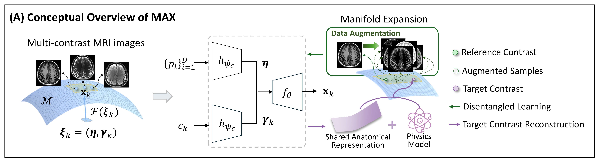
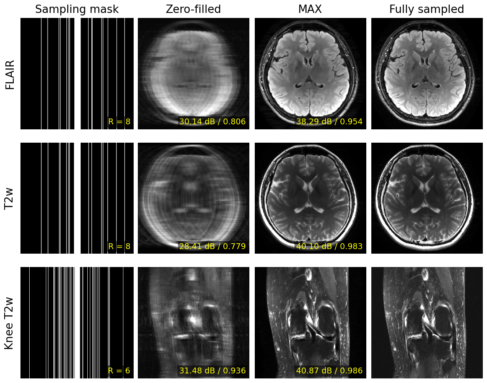

# Learning Subject-Specific Anatomical Representations via Manifold Expansion: Application to Accelerated Multi-Contrast MRI

[](https://arxiv.org/abs/2610.04028)

## Introduction

MAX (MAnifold eXpansion) reconstructs an undersampled MRI contrast (for example FLAIR), constrained by an anatomical
representation learned from a high-quality reference contrast of the same subject (for example MPRAGE).

Multi-contrast images of the same subject are viewed as points on a shared manifold. Each image is described by two parts: a code `η` for the anatomy, shared by all
contrasts, and a code `γ` for the contrast. When only a single high-quality reference image is available, it provides one point on this manifold, which
is not enough to separate the anatomy from the contrast. MAX therefore **expands the manifold** around the reference: data augmentation turns the
reference into many images with the same anatomy and different contrasts. A network trained on all of them learns the
shared anatomical representation `η` separately from the contrast codes (disentangled learning). To reconstruct the
target contrast, MAX keeps this anatomical representation fixed and fits only the contrast-specific part to the
undersampled k-space through the MRI physics model.



The code implements this in three steps:

1. **Augmentation** (`augmentation/`): a fixed set of 30 intensity-transformation chains is applied to the registered
   reference image. The result is a set of images that share the subject's anatomy but have different contrasts.
2. **Prior embedding** (`prior_embedding/`): a hash-encoding implicit neural representation (INR) is trained on all the
   augmented images, with one learnable latent code per image. Its coordinate encoder then holds the subject's anatomy,
   independent of contrast.
3. **Reconstruction** (`reconstruction/`):
   - Stage 1: an INR built on the frozen prior encoder is fitted to the measured k-space. Output: `x_inr`.
   - Stage 2: an unrolled network (CNN + conjugate-gradient data consistency) refines `x_inr`. The network is trained
     on the measured k-space only (zero-shot self-supervised, ZS-SSL). Output: `pred_image`.

## Installation

Needs an NVIDIA GPU with CUDA. Tested with Python 3.9, PyTorch 2.8 (CUDA 12.9), numpy 2.0, scipy 1.13, h5py 3.14 and
scikit-image 0.24.

```bash
pip install torch numpy scipy h5py scikit-image
pip install git+https://github.com/NVlabs/tiny-cuda-nn/#subdirectory=bindings/torch
```

See the [tiny-cuda-nn page](https://github.com/NVlabs/tiny-cuda-nn) if its build fails (it needs the CUDA toolkit and
a matching compiler).

## Data

Download the data from
[Google Drive](https://drive.google.com/drive/folders/1Qdkym2PUUCwq6tGwiAhYMrBl1mvSLhJo?usp=sharing) and put it in
`MAX_data/`.

| Case | Target | Reference | k-space (x, y, slices, coils) | Undersampling |
|---|---|---|---|---|
| `brain_FLAIR` | FLAIR | MPRAGE | 224 x 231 x 56 x 32 | R = 8, 1-D Gaussian, 12 ACS lines |
| `brain_T2w` | T2w | MPRAGE | 224 x 220 x 56 x 32 | R = 8, 1-D Gaussian, 12 ACS lines |
| `knee` | T2w | T1w | 384 x 308 x 32 x 15 | R = 6, 1-D Gaussian, 12 ACS lines |

Files in each case folder:

| File | Content |
|---|---|
| `*_kspace.mat` | multi-coil k-space, fully sampled; the undersampling mask is applied in the script |
| `*_tstCsm.mat` | coil sensitivity maps, same size as the k-space |
| `*_tissue_mask.mat` | tissue mask (variable `tissue_mask`) |
| `*_SamMask.mat` | 1-D phase-encoding undersampling mask (variable `SamMask`) |
| `Mprage2Flair.mat`, `Mprage2T2.mat`, `Knee_T1w2T2w.mat` | high-quality reference image |
| `selected_augmentations*.json` | the 30 augmentation chains with their recorded parameters |


## Usage

### Quick start

With no options, the three scripts run the brain FLAIR case: they read the input data from `MAX_data/brain_FLAIR`, and
each step reads the output of the previous one. Run all commands in this README from the `MAX-Reconstruction/` folder.

```bash
python augmentation/apply_augmentation.py   # -> augmentation/output/augmented_images.mat
python prior_embedding/train_prior.py       # -> prior_embedding/output/{encoder,latent_encoder,mlp}.pt
python reconstruction/reconstruct.py        # -> reconstruction/output/recon.mat
```

Use `--gpu-id N` to pick a GPU (for `train_prior.py` and the reconstruction scripts), and `-h` to list every option.
The steps below explain each script and show how to run the other cases.

### Step 1: augmentation

`apply_augmentation.py` applies the 30 augmentation chains of a `selected_augmentations*.json` file to the reference
image and keeps the tissue region. Each augmented image is scaled to [0, 1] inside the tissue mask.

- Inputs: `--reference` and `--reference-key` (reference image and its variable name), `--mask` and `--mask-key`
  (tissue mask), `--augmentations` (JSON file).
- Output (`--out`): `augmented_images` (30 x nx x ny x nz), `tissue_mask` and the chain metadata.

Brain T2w:

```bash
python augmentation/apply_augmentation.py \
    --reference MAX_data/brain_T2w/Mprage2T2.mat --reference-key Mprage2T2 \
    --mask MAX_data/brain_T2w/T2w_tissue_mask.mat \
    --augmentations MAX_data/brain_T2w/selected_augmentations_T2w.json \
    --out augmentation/output/augmented_images_T2w.mat
```

### Step 2: prior embedding

`train_prior.py` trains the hash-encoding INR on all augmented images (500 epochs, L1 loss inside the tissue mask).

- Input: `--augmented`, the output of step 1.
- Output (`--out-dir`): `encoder.pt`, `latent_encoder.pt`, `mlp.pt` (the prior) and `prior_embedding_meta.npz`
  (loss history, latent codes, mean fitted image).

Brain T2w:

```bash
python prior_embedding/train_prior.py \
    --augmented augmentation/output/augmented_images_T2w.mat --out-dir prior_embedding/output_T2w
```

For the knee, run steps 1 and 2 the same way with the files in `MAX_data/knee`:

```bash
python augmentation/apply_augmentation.py \
    --reference MAX_data/knee/Knee_T1w2T2w.mat --reference-key T1w2T2w \
    --mask MAX_data/knee/Knee_T2w_tissue_mask.mat \
    --augmentations MAX_data/knee/selected_augmentations_Knee.json \
    --out augmentation/output/augmented_images_Knee.mat
python prior_embedding/train_prior.py \
    --augmented augmentation/output/augmented_images_Knee.mat --out-dir prior_embedding/output_Knee
```

### Step 3: reconstruction

Stage 1 fits the INR with the frozen prior to the undersampled k-space (500 steps). Stage 2 refines it with an 8-block unrolled network trained on the whole volume.

- Inputs: `--kspace`, `--csm` (coil maps), `--tissue-mask`, `--reference`, `--sampling-mask`, each with a `--*-key`
  option for the variable name in the `.mat` file, and `--prior` (the output folder of step 2).
- `--acc R` draws a new 1-D Gaussian mask with acceleration R instead of reading `--sampling-mask`.
- `--modl-lr` sets the stage-2 learning rate (2e-4 for FLAIR, the default; 5e-4 for T2w).

Brain T2w:

```bash
python reconstruction/reconstruct.py \
    --kspace MAX_data/brain_T2w/T2w_kspace.mat --kspace-key T2w_kspace \
    --csm MAX_data/brain_T2w/T2w_tstCsm.mat --csm-key T2w_tstCsm \
    --tissue-mask MAX_data/brain_T2w/T2w_tissue_mask.mat \
    --reference MAX_data/brain_T2w/Mprage2T2.mat --reference-key Mprage2T2 \
    --sampling-mask MAX_data/brain_T2w/T2w_SamMask.mat \
    --prior prior_embedding/output_T2w --modl-lr 5e-4 --out reconstruction/output/recon_T2w.mat
```

knee:
```bash
python reconstruction/reconstruct_knee.py   # -> reconstruction/output/recon_Knee.mat
```

**Output.** Both scripts write a `.mat` file with:

- `pred_image`: the final MAX reconstruction.
- `x_inr`: the stage-1 INR image.
- `zf_image`: the zero-filled image.
- `SamMask`: the undersampling mask used.
- Training histories and settings.

Results of this code on the example data (one slice per case). 



## Citation

If you use this code, please cite:

```bibtex
@misc{feng2026learningsubjectspecificanatomicalrepresentations,
      title={Learning Subject-Specific Anatomical Representations via Manifold Expansion: Application to Accelerated Multi-Contrast MRI},
      author={Ruimin Feng and Wanyu Bian and Albert Jang and Zachary Stewart and Fang Liu},
      year={2026},
      eprint={2610.04028},
      archivePrefix={arXiv},
      primaryClass={cs.CV},
      url={https://arxiv.org/abs/2610.04028},
}
```

## Contacts

Intelligent Imaging Innovation and Translation Lab [[github](https://github.com/I3Tlab)] at the Athinoula A. Martinos
Center of Massachusetts General Hospital and Harvard Medical School

- Ruimin Feng (rfeng3@mgh.harvard.edu)
- Fang Liu (fliu12@mgh.harvard.edu)

149 13th Street, Suite 2301, Charlestown, Massachusetts 02129, USA
